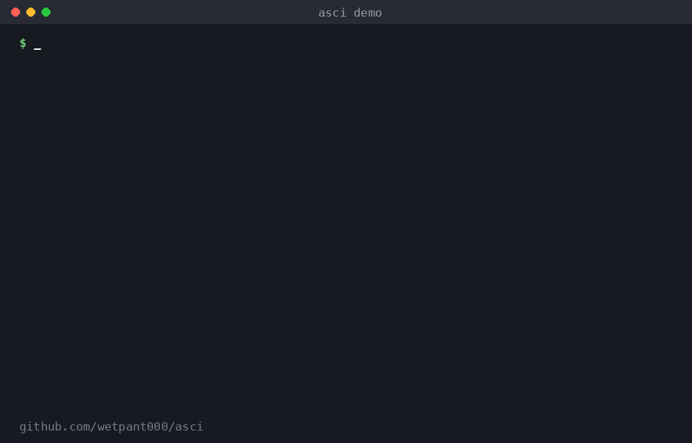

# asci

Type a word, get an ASCII picture in your terminal. Works **offline** on **Linux, macOS and Windows**.
It's a single Python file with no dependencies. On Windows there's also a standalone `.exe` that doesn't need Python.



```
$ asci -s "meow!" cat
 _______
< meow! >
 -------
    \
     \
   /\_/\
  ( o.o )
   > ^ <
  /     \
 (|     |)
  (_____)_/
  CAT
```

## Install

Every method installs two commands, `asci` and `asi`, which do the same thing.

**Linux / macOS (system-wide, with sudo):**

```sh
curl -fsSL https://raw.githubusercontent.com/wetpant000/asci/main/install.sh | sudo sh
```

**Windows (PowerShell, no admin needed):**

```powershell
irm https://raw.githubusercontent.com/wetpant000/asci/main/install.ps1 | iex
```

If Python is installed, the installer uses it. If not, it downloads the standalone `asci.exe`.
Open a new terminal afterwards so the updated PATH is picked up.

**Any OS with pip:**

```sh
pip install git+https://github.com/wetpant000/asci.git
```

**From a clone:** `sudo sh install.sh` (Linux/macOS) or `powershell -ExecutionPolicy Bypass -File install.ps1` (Windows).

## Usage

```sh
asci cat                     # picture of a cat
asi dog fish rocket          # several pictures
asci --side cat dog penguin  # next to each other
asci -s "hello!" cat         # speech bubble
asci -r                      # random picture
asci -c rainbow tree         # colors: red green yellow blue magenta cyan white rainbow
asci -f duck                 # mirrored
asci --border panda          # boxed
asci hello                   # no picture for this word? prints big letters
asci -b hi                   # always print big letters
asci -l                      # list everything
asci -l animals              # one category: animals food vehicles nature objects custom
echo pizza | asci            # read words from a pipe
asci --no-label cat > cat.txt
```

There are 90 pictures, including cat, dog, panda, dinosaur, whale, pizza, rocket, castle, guitar and pumpkin.
Related words like `kitty`, `puppy`, `bike` and `airplane` work, and so do plurals and small typos (`elefant`).

Color is turned off automatically when output is piped or when `NO_COLOR` is set.

## Your own pictures

Draw something in a text file, then:

```sh
asci --add dragon dragon.txt   # save it
asci dragon                    # use it
asci -l custom                 # list yours
asci --remove dragon           # delete it
```

Your pictures are stored in `~/.asci/` (`%APPDATA%\asci` on Windows), or in `$ASCI_HOME` if it's set.

## Uninstall

```sh
sudo sh uninstall.sh                                                            # Linux / macOS
irm https://raw.githubusercontent.com/wetpant000/asci/main/uninstall.ps1 | iex  # Windows
pip uninstall asci                                                              # pip
```

## Making a release

Push a version tag, e.g. `git tag v1.1.0 && git push --tags`.
GitHub Actions builds `asci.exe` on Windows and attaches it to a GitHub release.

## License

MIT
